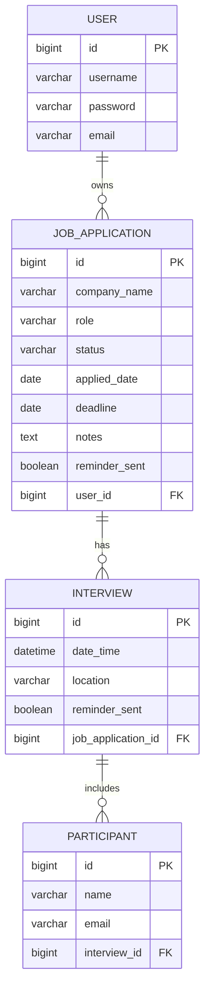

# ER-diagram — Job Application Tracker

## Relationer

- En **användare** kan ha många **jobbansökningar**.
- En **jobbansökan** kan ha många **intervjumöten**.
- Ett **intervjumöte** kan ha många **deltagare**.

## Statusvärden (jobbansökan)

- `APPLIED` — Sökt
- `INTERVIEW` — Intervju
- `REJECTED` — Avslagen
